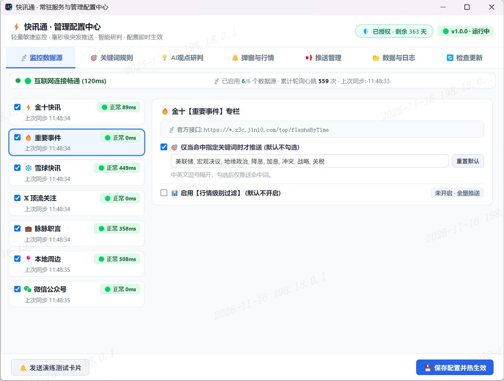

# 快讯通 (Kuaixuntong)

<p align="center">
  
</p>

<p align="center">
  <strong>专为交易者、宏观研究员与商业决策者打造的轻量级、跨平台突发快讯与商业情报桌面监控系统</strong><br />
  打破信息茧房与盯盘疲劳：从“人找信息”，转向“核心信息主动找你”。支持 <strong>Windows</strong>、<strong>macOS (Apple Silicon & Intel)</strong> 与 <strong>Linux (AppImage & deb)</strong> 三端跨平台桌面客户端，毫秒级感知全球突发，双核 AI 智能研判多空，桌面与手机移动端双轨秒级推送。
</p>

<p align="center">
  <a href="https://github.com/dengwka/kuaixuntong/releases"></a>
  <a href="https://github.com/dengwka/kuaixuntong/actions/workflows/build.yml"></a>
  
  
  
  
</p>

---

## 📖 项目简介

在信息高度过载的商业与金融市场中，传统的**“多开网页、高频盯盘、手动刷新”**不仅带来极大的注意力损耗，更容易错失关键的时间窗口。

**快讯通 (Kuaixuntong)** 是一款高颜值、生产级的轻量级跨平台情报感知与智能研判桌面客户端。系统以“极致低延迟、深度智能降噪、大模型认知研判与无感静默常驻”为核心设计原则，聚合全网财经突发、宏观决议、雪球 7×24、𝕏 (Twitter) 海外领袖推文、脉脉职言、本地周边规划民生与微信公众号权威推文。配合**双核大模型（DeepSeek-V3 / 智谱 GLM-4）及免 Key 本地金融规则库**，自动完成资产多空定性、行情影响打分与自选股票池穿透，并通过**电脑桌面视网膜透明微质感卡片与手机移动端（企业微信、飞书应用、钉钉）**双轨秒级触达。

---

## 🌟 核心特性

### 1. ⚡ 全渠道突发情报感知雷达
- **金十核心快讯与宏观专栏**：直连金十数据核心快讯与重要事件专栏（`-8200`），毫秒级捕获全球央行利率决议、非农、CPI、地缘局势与重磅政策。
- **雪球 7×24 财经异动**：全时段侦听 A股、港股、美股异动大单、监管处罚、公司重组与业绩暴雷公告。
- **𝕏 (Twitter) 顶流与海外机构订阅**：免翻墙、免登录官方 Syndication 协议监听海外政经领袖（马斯克、美联储、OpenAI 等），内置双通道中英文地道机翻，支持双语折叠核对与原推一键穿透。
- **脉脉高价值职言雷达**：捕获互联网大厂业务调整、高管变动、裁员求职与行业真实内幕声浪。
- **本地周边规划与民生问政**：直连自规局用地公示、地铁线网批复、环评公示与问政湖南热点答复，支持行政区与自选核心板块（如天心区省政府板块）超精准下钻过滤。
- **微信公众号与服务号实时监控**：直驱权威官媒（新华社、人民日报）与行业深度研报，支持后台微信扫码授权与免密自动保活。

### 2. 🧠 双核大模型 AI 观点研判 + 免 Key 本地规则兜底
- **异步解耦流式研判**：弹窗毫秒级弹出不卡顿，后台异步拉起大模型进行观点拆解与要点摘要，分析完成后秒级“注水”更新卡片。
- **五大类大宗与金融资产多空定性**：针对黄金、原油、美元、A股、加密货币进行多空定性，并给出综合**「行情影响评分（0~100分）」**。
- **免 Key 本地规则库兜底保障**：未配置 DeepSeek 或 GLM Key 时，系统自动调用内置数十万字金融规则库进行智能研判，完全零门槛开箱即用。

### 3. 🎯 个人自选持仓关联与强穿透提示
- **自选股票池深度关联**：支持在控制台维护个人自选股与持仓板块（如腾讯控股、半导体与硬科技、高股息央企）。
- **强烈利好/利空高亮警示**：当突发快讯命中自选标的底层产业链时，卡片顶部显著标出**「🎯 影响你的自选持仓：自选股票池 / 半导体与硬科技（强烈利好）」**，抢占交易先机。
- **底部实时资产看板轮播**：卡片底部动态展示自选股最新行情、国内金价、BTC / SOL 汇率及布伦特原油变动。

### 4. 📲 电脑桌面与手机移动端双轨推送
- **电脑桌面端原生视网膜悬浮卡片**：基于 Electron 原生轻量窗口，支持暗黑毛玻璃微质感、自适应文字缩放、支持一键收起、悬停暂停倒计时、声音提示与双击穿透原文。
- **手机移动端 Webhook 聚合分发**：
  - **通道 1：企业微信群机器人**（支持 20条/分频率控制，手机端秒级收到图文卡片）。
  - **通道 2：飞书消息推送**（支持**模式 1：群自定义机器人** 与 **模式 2：飞书智能体 / 自建应用**，支持用户单聊直推与团队群广播）。
  - 支持双端独立开关控制，互不干扰。

### 5. 🛡️ 灵活精准的抓取时效与降噪策略
- **五大时效过滤模式**：
  - ⚡ **极速突发模式 (≤ 2小时)**：仅推送超新鲜资讯，严密过滤任何迟发消息。
  - ☕ **半日聚焦模式 (≤ 12小时)**：适合半交易日与早晚盘追踪。
  - ☀️ **当日实时模式 (≤ 24小时 · 推荐)**：只推送当天最新发文，杜绝历史旧闻误弹。
  - 📅 **3天宽容模式 (≤ 72小时)**：适合周末复盘与深度政务。
  - 🌐 **全量历史模式**：调试专用，不设时效闸门。
- **关键词矩阵与一票否决**：支持配置全局高亮优先级关键词（如“突发、降息、加息、CPI、制裁”），命中自动加权并展示高亮徽章；支持一票否决黑名单，彻底过滤广告营销噪音。

### 6. 🔒 商业级单机硬件 MAC 绑定授权管理
- **一机一码物理绑定**：授权码与本机真实物理网卡 MAC 强绑定，防止多机盗用。
- **在线秒级激活与离线证书验签**：直连官方授权中心（`https://dengwk.ai.studio`），支持在线激活与离线 `.lic` 数字证书验签。
- **7 天断网容错宽限策略**：日常运行自动执行 24h 静默心跳；遇外网波动或短暂离线，系统自动进入 7 天本地宽限保护，核心情报监控绝不中断。

### 7. 🪟 全平台桌面客户端与 GitHub Actions 云端自动构建
- **全平台 3 端编译**：完整支持 **Windows 10/11 (x64)**、**macOS Apple Silicon (M1~M4 arm64)**、**macOS Intel (x64)** 以及 **Linux (AppImage / deb)**。
- **GitHub 自动化 CI/CD**：推送 Tag 自动触发三端云端流水线，多架构二进制文件自动打包并挂载至 GitHub Release。

---

## 🛠️ 系统技术架构

<p align="center">
  
</p>

### 系统分层设计说明：
1. **Layer 1 · 全渠道情报感知层 (Perception Grid)**：采用独立轮询引擎与事件监听器，各数据源独立线程调度，异常时指数避退，保障网络稳定性。
2. **Layer 2 · 降噪与智能研判中枢 (Intelligence Hub)**：接收原始事件，执行时效模式判定、双层 LRU 状态去重与自选持仓产业链穿透，并交由大模型 / 本地规则库并行解析。
3. **Layer 3 · 消息推送路由与多端网关 (Dispatch Gateway)**：根据用户配置的路由规则，将富文本快讯卡片无缝分发至原生桌面悬浮窗或移动端机器人。
4. **Layer 4 · 客户端呈现与运行时基座 (Presentation & Runtime)**：现代化暗黑微质感 UI、8 大标签可视化控制中心、MAC 授权认证中心与 Electron 跨平台打包基座。

---

## 🚀 快速上手

### 方式一：直接下载全平台桌面客户端（推荐 · v1.0.0 正式版）

前往项目的 [GitHub Releases 发布页面](https://github.com/dengwka/kuaixuntong/releases/tag/v1.0.0) 即可直接获取最新版本产物：

| 平台 / 芯片架构 | 安装包类型 | 产物文件名 | 说明 |
| :--- | :---: | :--- | :--- |
| 🪟 **Windows (x64)** | NSIS 安装版 | [`kuaixuntong-Setup-1.0.0.exe`](https://github.com/dengwka/kuaixuntong/releases/download/v1.0.0/kuaixuntong-Setup-1.0.0.exe) | 适用于 Windows 10/11 64位系统 |
| 🍏 **macOS Apple Silicon** | DMG 镜像 | [`kuaixuntong-1.0.0-arm64.dmg`](https://github.com/dengwka/kuaixuntong/releases/download/v1.0.0/kuaixuntong-1.0.0-arm64.dmg) | 适用于 M1 / M2 / M3 / M4 系列芯片机型 |
| 🍏 **macOS Apple Silicon** | 免安装便携包 | [`kuaixuntong-1.0.0-arm64.zip`](https://github.com/dengwka/kuaixuntong/releases/download/v1.0.0/kuaixuntong-1.0.0-arm64.zip) | 解压即用 |
| 🍎 **macOS Intel** | DMG 镜像 | [`kuaixuntong-1.0.0-x64.dmg`](https://github.com/dengwka/kuaixuntong/releases/download/v1.0.0/kuaixuntong-1.0.0-x64.dmg) | 适用于 Intel 架构 Mac 机型 |
| 🍎 **macOS Intel** | 免安装便携包 | [`kuaixuntong-1.0.0-x64.zip`](https://github.com/dengwka/kuaixuntong/releases/download/v1.0.0/kuaixuntong-1.0.0-x64.zip) | 解压即用 |
| 🐧 **Linux 通用** | AppImage 独立包 | [`kuaixuntong-1.0.0-x86_64.AppImage`](https://github.com/dengwka/kuaixuntong/releases/download/v1.0.0/kuaixuntong-1.0.0-x86_64.AppImage) | 赋予执行权限后双击即可运行 |
| 🐧 **Linux (Debian/Ubuntu)** | DEB 安装包 | [`kuaixuntong-1.0.0-amd64.deb`](https://github.com/dengwka/kuaixuntong/releases/download/v1.0.0/kuaixuntong-1.0.0-amd64.deb) | 支持 `sudo dpkg -i` 标准安装 |

> **macOS 首次安装提示已损坏打不开？**  
> 打开终端执行一行命令解除隔离即可：  
> `sudo xattr -cr /Applications/快讯通.app`

---

### 方式二：本地源码启动与二次开发

```bash
# 1. 克隆代码仓库
git clone https://github.com/dengwka/kuaixuntong.git
cd kuaixuntong

# 2. 安装项目依赖
npm install

# 3. 本地启动快讯通 (进入常驻与调试模式)
npm start
```

### 方式三：本地打包各平台客户端

```bash
# 构建 Windows 安装包 (.exe)
npm run dist:win

# 构建 macOS 安装映像 (.dmg & .zip)
npm run dist:mac

# 构建 Linux 安装包 (.AppImage & .deb)
npm run dist:linux
```

---

## 📱 移动端推送接入指南 (企业微信 & 飞书)

### 1. 企业微信机器人接入 (30秒完成)
1. 在企业微信电脑端，选择任意一个内部沟通群（或新建一个只有自己的“快讯接收群”）；
2. 点击右上角群设置 `...` -> **「添加群机器人」** -> **「新建」**，输入机器人名称（如：快讯通情报助手）；
3. 复制生成的 **Webhook 地址**；
4. 打开快讯通「管理配置中心」->「推送管理」-> 勾选「启用手机端推送服务总开关」与「通道1：企业微信机器人」，粘贴 Webhook 地址，点击「测试发送」即可验证！

### 2. 飞书消息推送接入
- **模式 1：群自定义机器人（推荐 · 极简）**：在飞书群设置中添加“自定义机器人”，将生成的 Webhook 粘贴到快讯通飞书通道中即可。
- **模式 2：飞书智能体 / 自建应用**：在飞书开放平台创建企业内部应用并开启机器人能力，将 `App ID` 与 `App Secret` 填入快讯通，可实现向个人账号的单聊精准直推。

---

## 📋 监控数据源与特性支持清单

| 数据源名称 | 抓取协议 / 机制 | 默认时效窗口 | AI 研判与多空定性 | 自选持仓穿透 | 说明 |
| :--- | :--- | :---: | :---: | :---: | :--- |
| **金十核心快讯** | CDN 毫秒级轮询 (`-8200`) | ≤ 2 小时 | ✅ 支持 | ✅ 支持 | 宏观央行、非农CPI、重磅突发 |
| **金十重要事件专栏** | 专题数据聚合接口 | ≤ 24 小时 | ✅ 支持 | ✅ 支持 | 重要专题、深度长文速报 |
| **雪球 7×24 快讯** | 证券异动接口 | ≤ 2 小时 | ✅ 支持 | ✅ 支持 | A股/港美股公告、大单异动、暴雷 |
| **𝕏 (Twitter) 顶流** | 免登免翻 Syndication 协议 | ≤ 12 小时 | ✅ 支持 | ✅ 支持 | 马斯克、美联储等海外领袖推文中英双语 |
| **脉脉职言热点** | 社交声浪抓取 | ≤ 24 小时 | ✅ 支持 | ⚪ 基础关联 | 大厂业务动向、裁员跳槽行业内幕 |
| **本地周边 · 规划政务** | 官方自规局与问政红网 | ≤ 24 小时 | ✅ 支持 | ⚪ 行政区级 | 用地公示、地铁审批、规划答复 |
| **微信公众号与服务号** | 实时订阅通道协议 | ≤ 24 小时 | ✅ 支持 | ✅ 支持 | 权威官媒（新华社/人民日报）与深度研报 |

---

## 📁 目录结构

```
kuaixuntong/
├── .github/
│   └── workflows/
│       └── build.yml               # GitHub Actions Windows/macOS/Linux 3端并发云打包流水线
├── assets/
│   ├── app_icon.ico                # Windows 应用图标
│   ├── app_icon.icns               # macOS 应用高清矢量图标
│   ├── app_icon.png                # Linux 与跨平台图标
│   ├── tray_icon.png               # 系统托盘图标
│   └── wechat_contact_qr.png       # 授权咨询微信二维码
├── docs/
│   └── architecture.svg            # 快讯通系统全景技术架构图 (SVG)
├── src/
│   ├── collectors/                 # 7 大数据源采集器 (金十、雪球、X、脉脉、本地周边、微信等)
│   ├── ui/
│   │   ├── alert.html / alert.js   # 桌面视网膜黑金微质感卡片弹窗
│   │   ├── settings.html / js      # 常驻管理配置中心控制台 (8大功能标签)
│   │   └── licenseModal.html / js  # 商业授权管理与 MAC 绑定弹窗
│   ├── aiAnalyzer.js               # 双核大模型 (DeepSeek / GLM-4) 研判与免 Key 本地规则库
│   ├── configManager.js            # 本地配置热加载与持久化中心
│   ├── filterEngine.js             # 降噪过滤、时效控制与自选股票池匹配引擎
│   ├── licenseManager.js           # MAC 物理绑定、在线激活与 24h 心跳验签
│   ├── mobileNotifier.js           # 移动端 Webhook 推送网关 (企业微信、飞书、钉钉)
│   ├── main.js                     # Electron 主进程 (窗口管理、托盘常驻、IPC通道)
│   └── preload.js                  # 上下文隔离与安全 IPC 桥接
├── package.json                    # 依赖配置与跨平台构建脚本
├── RELEASE_NOTES.md                # v1.0.0 全景功能发布说明
└── README.md                       # 项目主文档
```

---

## ⚠️ 免责声明 (Disclaimer)

1. 本软件获取的所有资讯、数据与 AI 观点研判内容仅供个人阅读参考、信息辅助与学术研究，不构成任何实质性的投资建议或买卖依据；
2. 市场有风险，投资需谨慎。用户因依赖软件推送的资讯或 AI 观点做出的任何投资决策，风险自担；
3. 本软件尊重各内容平台的知识产权，抓取与监控仅限公开发布的信息源，请勿将本软件用于任何非法渗透或恶意并发采集活动。

---

## 📄 开源协议 (License)

本项目采用 [MIT License](LICENSE) 开源协议。
