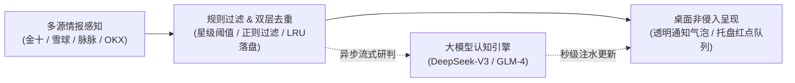

# 快讯通 (KuaixunTong)

> **打破信息茧房与盯盘疲劳：从“人找信息”，转向“核心信息主动找你”。**  
> 专为交易者、宏观研究员与商业决策者打造的轻量级跨平台突发快讯与商业情报桌面监控系统。

[](https://github.com/dengwka/kuaixuntong/releases)
[](LICENSE)
[]()
[](https://github.com/dengwka)

---

## 💡 为什么需要快讯通？

在信息高度过载的商业与金融市场中，传统的**“多开网页、高频盯盘、手动刷新”**不仅带来极大的注意力损耗，更容易错失时间窗口：

* 🎯 **主动捕获，抢占先机**：将传统“人肉刷新闻”重构为“高价值情报主动触达”，第一时间感知全球宏观事件、监管动向与行业异动。
* 🔇 **降噪过滤，只看关键**：基于星级权重与自定义关键词矩阵，过滤 95% 无关噪音，杜绝无效弹窗干扰。
* ⚡ **AI 秒级定性**：接入大模型异步研判管道，极速输出利好/利空倾向与 50 字核心要点，辅助迅速决策。
* 🍃 **静默陪伴，零存在感**：待机内存低于 80MB，支持夜间免打扰调度；工作时不侵占屏幕，突发时一目了然。

---

## 🏛️ 系统架构



---

## 🚀 核心特性

- **多源情报秒级聚合**：原生集成金十数据核心快讯（`-8200`）、宏观重大专题、雪球 7x24 及脉脉职言突发动态；支持 BTC/SOL 等加密现货与合约行情盯盘。
- **双层状态去重机制**：内存哈希环（LRU）结合本地持久化存储，保障异常退出或断电重启后零漏报、零重复。
- **异步解耦 LLM 研判**：通知弹窗毫秒级即时展示，大语言模型后台异步解析事件多空倾向与核心摘要，不阻塞主线程。
- **智能免打扰与未读回溯**：可配置静音时段，消息静默聚合至系统托盘；支持历史快讯随时调阅。
- **端到端隐私安全**：Local-First 设计，所有 API Key、监控规则与缓存数据仅留存于本地，无任何第三方云端遥测与追踪。

---

## ⚙️ 核心配置 (`config.json`)

系统配置文件存放于本地用户数据目录，可通过可视化控制台或直接编辑调整：

```json
{
  "system": {
    "poll_interval_sec": 5,        // 轮询频率 (秒)
    "quiet_hours": { "enabled": true, "start_time": "23:00", "end_time": "08:00" }
  },
  "sources": {
    "jin10": { "enabled": true, "min_star": 3, "weight": 80 },
    "jin10_topic": { "enabled": true, "weight": 95 },
    "xueqiu": { "enabled": true, "weight": 75 },
    "maimai": { "enabled": true, "weight": 75 }
  },
  "rules": {
    "min_alert_score": 60,         // 综合触发阈值分
    "highlight_keywords": ["突发", "降息", "加息", "非农", "CPI", "制裁", "违约"]
  },
  "ai_analysis": {
    "enabled": true,
    "deepseek_api_key": "sk-...",  // 支持 DeepSeek-V3 / GLM-4 双模型容灾
    "timeout_sec": 6
  }
}
```

---

## 📦 下载与安装

已编译产物可前往 👉 [**GitHub Releases**](https://github.com/dengwka/kuaixuntong/releases) 直接获取：

- **Windows**: 下载 `kuaixuntong-Setup-1.0.0.exe` 安装运行。
- **macOS**: 下载 `kuaixuntong-1.0.0.dmg` 拖拽安装（如遇 Gatekeeper 拦截，在终端执行 `sudo xattr -cr /Applications/快讯通.app` 即可）。

### 开发者模式
```bash
# 安装依赖并本地启动
npm install
npm start

# 构建分发包
npm run dist:win   # Windows NSIS
npm run dist:mac   # macOS DMG / ZIP
```

---

## 📄 License

[MIT License](LICENSE) © 2026 [dengwk](https://github.com/dengwka)
