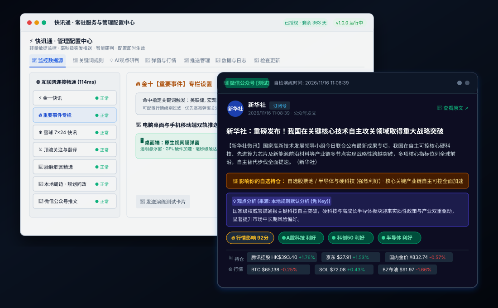
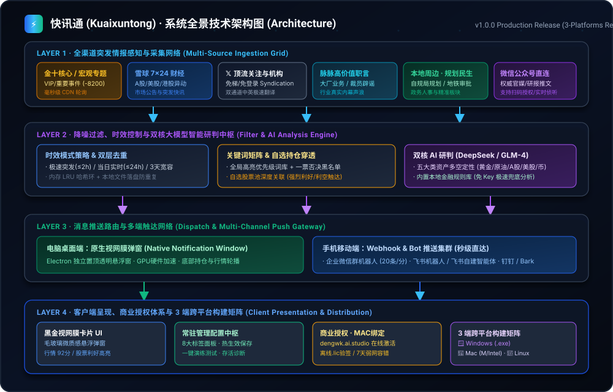

# 快讯通 (KuaixunTong)

<p align="center">
  
</p>

<p align="center">
  <strong>专为高净值交易者、宏观研究员与商业决策者打造的轻量级全渠道突发情报监控与 AI 研判助手</strong><br />
  打破信息茧房与盯盘疲劳：从“人肉刷新闻”，转向“高价值核心情报主动触达”。全天候毫秒级感知全球政经要闻，原生支持 <strong>Windows (.exe)</strong>、<strong>macOS Apple Silicon (M芯片 arm64)</strong>、<strong>macOS Intel (x64)</strong> 与 <strong>Linux (AppImage / deb)</strong> 全平台桌面端，内置双核大模型 AI 观点研判与自选持仓利空利好穿透，提供电脑视网膜微质感悬浮卡片与移动端 (企业微信 / 飞书 / 钉钉) 双轨推送。
</p>

<p align="center">
  <a href="https://github.com/dengwka/kuaixuntong/releases"></a>
  <a href="https://github.com/dengwka/kuaixuntong/actions"></a>
  
  
  
  
</p>

---

## 📖 项目简介

在信息高度过载、瞬息万变的全球金融与商业市场中，传统的**“多开网页、高频盯盘、手动刷新”**不仅带来极大的认知负担与精力损耗，更容易因几分钟的信息滞后而错失黄金决策窗口。

**快讯通 (KuaixunTong)** 是一款高颜值、工业级、轻量高效的跨平台商业情报与金融快讯实时监控客户端。系统常驻于系统托盘，后台毫秒级侦听金十核心快讯、宏观重要专题、雪球 7×24 财经、𝕏 (Twitter) 顶流领袖推文、脉脉高价值职言、本地周边政务规划问政以及微信公众号推文。通过**“时效控制 + 双层哈希去重 + 关键词规则降噪 + 双核大模型认知分析 + 自选股票池穿透”**的全链路闭环，让真正重要的情报第一时间浮现在你的桌面与移动设备上。

---

## 🌟 核心特性

### 1. ⚡ 7 大全渠道突发情报感知雷达
- **🔥 金十核心快讯与【重要事件】专栏**：
  - 直连官方核心 CDN 接口 (`-8200` 实时快讯与 `/top/flashsByTime` 重大事件)；
  - 支持仅当命中指定宏观关键词（如：美联储、降息、加息、地缘政治、关税、冲突、非农等）时精准推送；
  - 内置【行情级别过滤】，自动过滤非关键低波杂音。
- **❄️ 雪球 7×24 实时财经快讯**：
  - 毫秒级接入沪深 A 股、港股、美股异动与监管通报，盘中突发异动、公司重磅公告零延迟呈现。
- **🌐 𝕏 (Twitter) 顶流领袖与机构推文监听（免翻墙 · 免登录）**：
  - 基于官方 Syndication 协议逆向直驱，无需海外代理、无需登录个人账号即可实时追踪马斯克、OpenAI、美联储等海外顶流动态；
  - 内置双通道中英极速翻译引擎，卡片端支持双语折叠核对与一键穿透原推文链接。
- **💼 脉脉职言高价值行业声浪**：
  - 实时抓取各大互联网大厂与硬科技巨头的业务动态、裁员调薪、内部爆料与行业辟谣，把握第一手产业真实脉搏。
- **📍 本地周边 · 城市规划与民生问政**：
  - 直连红网民生问政与城市自然资源和规划局官方公开通道；
  - 覆盖规划公示、用地调整、地铁线路审批、拆迁安置、楼市新政与政务人事调动；
  - 支持按行政区、精准片区板块与自选关注意向（如意向小区/学区）进行个性化过滤。
- **💬 微信公众号与服务号推文实时监控**：
  - 接入官方权威央媒（新华社、人民日报等）、顶流自媒体与主流券商投研号；
  - 支持扫码授权与官方协议直推，公众号一发文即可瞬间触发桌面与手机推送。

### 2. 💡 双核大模型 AI 观点研判与免 Key 本地规则兜底
- **🧠 双核大语言模型接入 (DeepSeek-V3 / 智谱 GLM-4)**：
  - 异步解耦研判架构：通知卡片秒级弹出，后台模型异步解析，绝不阻塞主线程；
  - 自动提炼 50 字极简核心观点，输出事件多空倾向与逻辑研判。
- **📊 五大类大类资产多空量化与行情影响分**：
  - 针对黄金、美元、原油、A股科技、虚拟币等主流资产自动进行利好/利空定性；
  - 输出 0~100 分的高置信度【行情影响分值】（如：行情影响 92分）。
- **🛡️ 内置金融量化规则库 (免 Key 极速兜底)**：
  - 未配置或未启用云端 API Key 时，系统自动无缝切换至内置的本地规则分析引擎，零门槛开箱即用。

### 3. 🎯 自选股票池与个人持仓智能匹配穿透
- **📌 个人持仓与重点股票池深度绑定**：
  - 在配置面板中维护你的自选关注板块与持仓标的（如：腾讯控股、半导体与硬科技、新能源、科创50 等）；
- **🚨 强烈利好 / 强烈利空醒目横幅**：
  - 当突发重磅消息触发时，卡片正中以醒目的橙黄色徽章直接标出：`🎯 影响你的自选持仓：自选股票池 / 半导体与硬科技 (强烈利好)`，一眼看透行情对个人资产的核心影响。

### 4. 📲 电脑桌面与手机移动端双轨推送分发网络
- **🖥️ 电脑端：黑金微质感视网膜卡片 (Retina Card Window)**：
  - 基于 Electron 原生无边框透明窗口开发，支持 GPU 硬件加速；
  - 黑金微质感毛玻璃视觉、高亮关键词徽章、来源标签、官方原文直达；
  - 底部集成个人持仓与全球主流宏观资产（美股、港股、国内金价、BTC、SOL、原油等）实时滚动行情看板。
- **📱 手机端：全渠道 Webhook & 智能体机器人推送**：
  - **通道 1：企业微信群机器人**（企业微信 App 毫秒级弹窗，每分钟 20 条防流控调度）；
  - **通道 2：飞书消息推送**（支持「群自定义机器人」与「飞书智能体 / 自建应用」单聊直推）；
  - **更多通道**：支持钉钉群机器人与 iOS Bark 离线推送，双端独立总开关控制。

### 5. ⏱️ 抓取时效策略与工业级降噪防重复
- **⏳ 5 大时效模式自由切换**：
  - **极速突发模式 (≤ 2小时)**：仅推送超新鲜高频资讯，严密过滤延误消息；
  - **半日聚焦模式 (≤ 12小时)**：适合半交易日与早晚盘追踪；
  - **当日实时模式 (推荐 · ≤ 24小时)**：只推送当天最新快讯，严厉拦截隔天旧闻；
  - **3天宽容模式 (≤ 72小时)**：适合周末复盘与深度政务追踪；
  - **全量历史模式**：调试专用，不设时效阀门。
- **🔍 关键词与一票否决黑名单**：
  - 支持自定义全局高亮优先级关键词（命中即提权弹窗并附带高亮徽章）；
  - 支持一票否决黑名单过滤词，彻底净化无关营销水文。
- **🔄 内存 LRU + 本地持久化双层去重**：
  - 毫秒级哈希环排重，结合本地磁盘冷持久化，哪怕异常重启或断网恢复，也绝不重复弹窗。

### 6. 🔐 单机硬件 MAC 绑定商业授权管理
- **💻 一机一码硬件设备绑定**：
  - 基于本地物理真实网卡 MAC 地址生成设备专属指纹，杜绝未经授权的多端复制；
- **🌐 在线授权码激活与离线验签**：
  - 直连官方授权中台 (`https://dengwk.ai.studio`)，秒级在线激活并绑定设备；
  - 支持导出/导入离线 `.lic` 证书验签，适应无外网涉密隔离办公网络；
- **🛡️ 24 小时后台静默心跳与 7 天断网容错**：
  - 激活后日常全自动后台静默心跳续期，如遇外网短暂波动，自动激活最长 7 天的本地宽限授权，业务监控从不断流。

### 7. ☁️ 3 端跨平台构建矩阵与 GitHub Actions 自动化流水线
- **跨平台矩阵全面覆盖**：Windows (x64)、macOS (Apple Silicon M1~M4 arm64 与 Intel x64)、Linux (AppImage 与 deb)；
- **GitHub Actions 云端 CI**：多虚拟主机并发编译，代码打 Tag 即自动构建发布。

---

## 🛠️ 系统技术架构

快讯通采用清晰的分层解耦设计，自底向上分为 **全渠道情报感知层**、**降噪与 AI 研判中枢层**、**推送路由与多端分发网络** 以及 **客户端呈现与跨平台运行基座**：

<p align="center">
  
</p>

### 架构各层核心职责说明：
1. **LAYER 1 · 全渠道突发情报感知与采集网络 (Multi-Source Ingestion Grid)**：
   - 统一调度金十、雪球、𝕏、脉脉、本地政务及微信公众号六大异构数据源，提供毫秒级请求重试、官方 CDN 穿透、Syndication 协议拉取与多通道翻译。
2. **LAYER 2 · 降噪过滤、时效控制与双核大模型智能研判中枢 (Filter & AI Analysis Engine)**：
   - 执行时效窗口剪裁（2h/12h/24h/72h）、双层 LRU 落盘去重、全局黑白名单正则过滤，并异步流式调用 DeepSeek / GLM-4 大模型或内置金融规则引擎输出量化多空研判。
3. **LAYER 3 · 消息推送路由与多端触达网络 (Dispatch & Multi-Channel Push Gateway)**：
   - 消息通过路由中枢分为两条独立管道：一条送往本地 Electron 原生置顶弹窗系统，另一条送往移动端 Webhook 调度池（企微、飞书、钉钉、Bark）。
4. **LAYER 4 · 客户端呈现、商业授权体系与 3 端跨平台构建矩阵 (Client Presentation & Distribution)**：
   - 负责管理配置控制台的 8 大标签页交互、视网膜微质感黑金卡片渲染、基于物理 MAC 的商业授权校验与 3 端云打包分发。

---

## 🚀 快速上手

### 方式一：直接下载全平台桌面客户端（推荐）

前往项目的 [GitHub Releases 发布页面](https://github.com/dengwka/kuaixuntong/releases) 即可直接下载官方正式版 (`v1.0.0`)：

| 平台 / 芯片架构 | 安装包类型 | 文件名 | 说明 |
| :--- | :--- | :--- | :--- |
| **Windows 10 / 11 (x64)** | NSIS 安装版 | `kuaixuntong-Setup-1.0.0.exe` | 推荐，支持桌面/开始菜单快捷方式与自动更新 |
| **macOS Apple Silicon** | DMG 映像 | `kuaixuntong-1.0.0-arm64.dmg` | 专为 M1/M2/M3/M4 芯片深度优化，极速运行 |
| **macOS Apple Silicon** | ZIP 压缩包 | `kuaixuntong-1.0.0-arm64.zip` | M 芯片免安装便携版 |
| **macOS Intel (x64)** | DMG 映像 | `kuaixuntong-1.0.0-x64.dmg` | 适用于所有 Intel 处理器的 Mac 机型 |
| **macOS Intel (x64)** | ZIP 压缩包 | `kuaixuntong-1.0.0-x64.zip` | Intel 处理器免安装便携版 |
| **Linux 通用架构 (x64)** | AppImage | `kuaixuntong-1.0.0-x86_64.AppImage` | 赋予执行权限即可双击运行 (`chmod +x`) |
| **Linux Debian / Ubuntu** | DEB 安装包 | `kuaixuntong-1.0.0-amd64.deb` | 支持 `sudo dpkg -i` 标准系统级安装 |

> [!TIP]
> **macOS 首次安装提示“已损坏”或无法打开？**  
> 这是由于 macOS Gatekeeper 安全机制所致，在 Mac 终端中执行一行命令即可解除：  
> `sudo xattr -cr /Applications/快讯通.app`

---

### 方式二：本地源码启动与调试

```bash
# 1. 克隆代码仓库
git clone https://github.com/dengwka/kuaixuntong.git
cd kuaixuntong

# 2. 安装项目依赖
npm install

# 3. 启动桌面客户端
npm start
```

---

### 方式三：本地打包构建全平台分发文件

```bash
# 构建 Windows 安装包 (.exe)
npm run dist:win

# 构建 macOS 安装包 (.dmg & .zip)
npm run dist:mac

# 构建 Linux 安装包 (.AppImage & .deb)
npm run dist:linux
```
构建产物将输出在本地 `release/` 目录下。

---

## 📋 全渠道情报数据源支持矩阵

| 数据源名称 | 采集协议 / 机制 | 监控时效 | AI 研判支持 | 重点监控内容与适用场景 |
| :--- | :--- | :--- | :--- | :--- |
| **⚡ 金十财经快讯** | 官方核心接口直连 | 毫秒级 (~100ms) | ✅ 深度量化 | 全球央行利率决议、非农、CPI、地缘政治与宏观经济突发 |
| **🔥 金十重要事件专栏** | VIP 重要事件 (-8200) | 秒级轮询 | ✅ 深度量化 | 顶级宏观决议、美联储表态、关税战略决策，支持关键词强过滤 |
| **❄️ 雪球 7×24 财经** | 雪球开放 API 轮询 | 秒级 (~500ms) | ✅ 深度量化 | A股盘中异动、上市公司重大资产重组、停复牌与监管问询 |
| **🌐 𝕏 (Twitter) 顶流** | 免登 Syndication + 双通道翻译 | 秒级直达 | ✅ 深度量化 | 马斯克、OpenAI、美联储等海外顶流动态，自动地道中文转译 |
| **💼 脉脉高价值职言** | 职言热点 API 逆向 | 分钟级调度 | ✅ 观点分析 | 大厂业务变阵、团队裁员招聘、高管变动与行业内幕爆料 |
| **📍 本地周边 · 规划问政** | 红网民生 + 自然资源规划局 | 建议 180s 轮询 | ✅ 自动提炼 | 城市轨道交通审批、自规局用地公示、楼市调控新政、政务人事 |
| **💬 微信公众号与服务号** | 微信开放平台 / 实时推送 | 秒级直驱 | ✅ 深度量化 | 新华社、人民日报等权威官媒推文，顶级机构深度投研研报 |

---

## 📲 移动端推送配置指引

快讯通支持将突发情报同步推送到你的手机设备，无论在开会、出差或离开工位，均能一手掌握最新情报：

### 1. 配置企业微信群机器人（通道 1）
1. 在电脑端企业微信中，进入任意工作群（或创建一个只有你自己的单人通知群）；
2. 点击群设置右上角 **「群机器人」** -> **「添加机器人」** -> **「新创建」**；
3. 为机器人命名（例如“快讯通突发助手”），复制生成的 **Webhook 地址**；
4. 打开快讯通控制台 **「推送管理」** 标签页，勾选 **「启用手机端推送服务总开关」** 与 **「通道 1：企业微信机器人」**，将 Webhook 粘贴到输入框中；
5. 点击右侧 **「测试发送」** 按钮，收到测试卡片即代表配置成功！

### 2. 配置飞书消息推送（通道 2）
- **模式 1：群自定义机器人（快速极简）**：在飞书群中添加自定义机器人，复制 Webhook 地址填入即可；
- **模式 2：飞书智能体 / 自建应用（支持单聊直推）**：
  1. 登录 [飞书开放平台](https://open.feishu.cn/)，创建企业自建应用；
  2. 开启“机器人”能力，获取应用的 `App ID` 与 `App Secret` 填入快讯通配置面板；
  3. 输入接收目标飞书用户的邮箱或群 ID，即可实现直接单聊将突发卡片推送到个人飞书。

---

## 🔐 软件授权激活与常见问题

### 1. 如何激活软件 License？
1. 打开快讯通，未授权状态下可正常浏览与修改各项配置；
2. 点击右上角授权状态栏进入 **「License 软件授权管理」** 弹窗；
3. 将面板中展示的本机 **「设备 MAC」** 发送给作者微信（可在弹窗中扫码添加）获取正式授权码；
4. 将授权码填入输入框，点击 **「激活并绑定本机」** 即可立即永久激活；
5. 若设备处于隔离外网的纯内网环境，可点击 **「导入离线 .lic 证书」** 进行单机离线验签。

### 2. 断网或出差时会影响使用吗？
不会！快讯通拥有健全的容错与弱网降级策略：
- 只要成功激活过一次，日常若遇外网波动或暂时断网，系统将自动激活最长 **7 天本地宽限授权**，监控与推送服务绝不断流；
- 重新连网后，后台将自动静默完成心跳验签并顺延有效期。

---

## 📁 目录结构

```
kuaixuntong/
├── .github/
│   └── workflows/
│       └── build.yml               # GitHub Actions 跨平台 3 端并发云打包流水线 (Win/Mac/Linux)
├── assets/                         # 应用图标、托盘徽章与二维码资源
│   ├── app_icon.ico                # Windows 应用程序图标
│   ├── app_icon.icns               # macOS 应用程序图标
│   ├── app_icon.png                # Linux 应用程序图标
│   └── tray_icon.png               # 系统托盘动态提示图标
├── docs/                           # 官方设计文档与矢量架构图
│   ├── architecture.svg            # 快讯通系统全景技术架构图 (SVG)
│   └── preview.svg                 # 快讯通客户端全景运行预览图 (SVG)
├── src/
│   ├── main.js                     # Electron 主进程入口 (生命周期、单例守护、托盘管理)
│   ├── store.js                    # 本地配置与状态持久化管理器
│   ├── licenseManager.js           # 商业授权中台客户端 (MAC绑定、在线激活、心跳、.lic验签)
│   ├── aiAnalysisManager.js        # 双核 LLM 智能研判调度器 (DeepSeek / GLM-4 / 本地规则)
│   ├── crawlerManager.js           # 核心轮询抓取调度总控
│   ├── pushManager.js              # 移动端 Webhook 推送网关 (企业微信、飞书、钉钉、Bark)
│   ├── notificationWindow.js       # 视网膜黑金悬浮卡片窗口调度器
│   ├── deduplicationManager.js     # 双层去重引擎 (内存 LRU + 本地落盘)
│   ├── sources/                    # 7 大情报数据源抓取驱动实现
│   │   ├── jin10Source.js          # 金十核心快讯驱动
│   │   ├── jin10TopicSource.js     # 金十重要事件专栏驱动
│   │   ├── xueqiuSource.js         # 雪球 7×24 财经驱动
│   │   ├── twitterSource.js        # 𝕏 顶流关注与双通道翻译驱动
│   │   ├── maimaiSource.js         # 脉脉高价值职言驱动
│   │   ├── localNewsSource.js      # 本地周边与规划民生驱动
│   │   └── wechatSource.js         # 微信公众号推文驱动
│   └── ui/                         # 前端交互与配置中心
│       ├── settings.html           # 管理配置中心主界面 (8 大功能标签页)
│       ├── settings.js             # 配置中心业务逻辑与热生效处理
│       ├── notification.html       # 悬浮视网膜通知卡片 UI
│       └── notification.js         # 通知卡片动画与行情轮播渲染
├── package.json                    # 项目元数据与全平台打包脚本
├── RELEASE_NOTES.md                # 官方各版本发布说明文档
└── README.md                       # 项目全景说明文档
```

---

## ⚠️ 免责声明 (Disclaimer)

1. **信息参考用途**：本软件所提供的所有突发快讯、AI 观点研判与大类资产多空倾向仅供参考交流与宏观研究使用，**不构成任何形式的投资建议或操作指引**。用户据此做出的任何投资决策与风险盈亏由使用者自行承担；
2. **数据版权与第三方协议**：各数据源内容版权均归原平台及作者所有，快讯通仅提供个人本地化聚合与便捷监控呈现能力，请合理配置轮询频率，遵守各平台的服务规范；
3. **隐私与安全承诺**：快讯通恪守 Local-First 原则，用户的自选持仓、关键词黑白名单、API Key 等敏感配置完全保留在用户本地机器中，绝不上报任何私人业务数据。

---

## 📄 开源协议 (License)

本项目采用 [MIT License](LICENSE) 开源协议。
Copyright © 2026 [dengwk](https://github.com/dengwka). All rights reserved.
