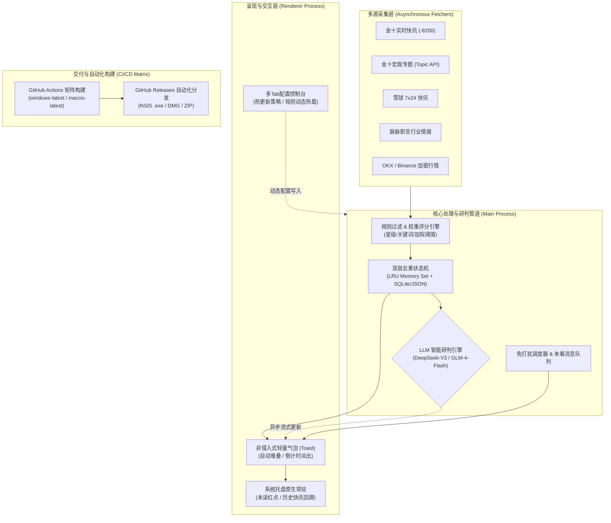

# 快讯通 (KuaixunTong)

> **轻量级跨平台突发快讯与宏观事件监控系统**  
> 面向对突发信息时效性、信噪比与系统低功耗有严苛要求的金融交易者与量化研究人员设计。

[](https://github.com/dengwka/kuaixuntong/releases)
[](LICENSE)
[]()
[]()

---

## 1. 架构总览与设计理念

`快讯通` 是一款基于 Electron 架构设计的常驻轻量化桌面监控应用。系统旨在解决金融突发新闻与宏观异动监控中常见的**延迟高、信噪比低、资源占用大、弹窗侵入性强**等痛点。

### 核心设计原则
- **极低功耗与无感知常驻**：后台待机内存占用控制在 80MB 以下，主进程事件循环基于高精度调度器，窗口仅在消息激活时执行非阻塞渲染。
- **高吞吐管道与去重保证**：多源采集、分级评分、正则清洗与双层持久化去重引擎，保证高并发突发下零漏报、零重复。
- **异步解耦的 LLM 研判管道**：将实时通知渲染与大模型语义研判彻底解耦，毫秒级优先展示原始内容，LLM 研判结果异步流式注水。
- **本地优先（Local-First）与零隐私泄露**：API Key、历史快讯与用户策略全部保存在本地，无中间代理服务器，无任何行为遥测与追踪。



---

## 2. 核心技术特性

### 2.1 多源异构数据流聚合与动态轮询
- **金十数据核心管道**：直接对接底层实时快讯接口（`-8200` 通道）与高优先级宏观专题接口，支持按星级（1~5星）与加权评分执行硬门槛截断。
- **雪球 7x24 行情与研报快讯**：聚合全市场异动快讯，内置 Cookie 鉴权扩展槽位。
- **脉脉行业情报采集**：针对科技大厂组织架构调整、裁员及涉案等特种情报的定向监测。
- **实时加密衍生品行情接入**：基于 OKX 公共接口的秒级聚合与币种自动标准化识别（支持 `BTC`、`SOL`、`BZ`、`CRCL` 等现货与合约代码格式）。

### 2.2 双层持久化去重引擎
- **内存哈希环（LRU Cache）**：毫秒级 O(1) 过滤高频重复推送请求。
- **磁盘状态落盘机制**：基于原子写入保存已推送记录与未看消息状态，即使遭遇异常断电或客户端重启，依然能保证历史快讯不漏不重。
- **自动滚动淘汰策略**：内置存储巡检守护任务，支持配置历史保留天数（默认 3 天）与存储容量软上限，自动执行日志与数据碎片整理。

### 2.3 异步解耦的大模型认知研判
- **多模型负载与容灾切换**：原生集成 `DeepSeek-V3` (`deepseek-chat`) 与智谱 AI (`glm-4-flash`)，提供多供应商轮询与超时故障转移。
- **预期/未决事件感知**：自研正则模式匹配算法，在调用 LLM 前精准识别“将于XX公布”、“日程提醒”等未决消息，避免模型对未来事件进行虚假归因。
- **语义研判矩阵**：实时输出利好/利空/中性评级、关键影响度评级及 50 字以内核心摘要，并对受影响标的进行实体抽取。

### 2.4 非侵入式桌面呈现系统
- **原生透明分层视窗**：采用无边框透明渲染模式，自动适配多显示器 DPI 缩放与工作区边缘贴靠。
- **免打扰时段调度机制**：可自定义静音时间段（如 `23:00 - 08:00`）。在静音时段内，系统静默聚合突发信息至未看队列，托盘图标以红点呈现，杜绝强打扰。
- **未看消息队列管理**：支持一键回溯历史快讯，已读/未读状态实时同步。

### 2.5 自动化增量检测与在位安装
- 集成 GitHub Releases 自动化检测管道，采用语义化版本规范（SemVer）比对。
- 支持**后台静默检测**与**一键流式拉取并自动拉起安装程序**，降低运维成本。

---

## 3. 代码拓扑与工程结构

```text
kuaixuntong/
├── .github/
│   └── workflows/
│       └── build.yml             # GitHub Actions 跨平台矩阵构建流水线 (Win/macOS)
├── assets/
│   ├── app_icon.ico              # Windows 原生图标资源
│   ├── app_icon.icns             # macOS 原生图标资源
│   └── tray_icon.png             # 状态栏/系统托盘高分辨率像素图标
├── src/
│   ├── main.js                   # 应用程序主进程入口、生命周期控制与 IPC 协调器
│   ├── config.js                 # 全局配置管理器 (支持运行时动态重载与多环境回退)
│   ├── history.js                # 双层持久化去重引擎与未读队列管理器
│   ├── strategy.js               # 评分过滤引擎 (星级截断、正则匹配与黑白名单过滤)
│   ├── cleaner.js                # 自动存储清理巡检守护进程 (滚动消除过期日志与快照)
│   ├── financialAi.js            # 大模型研判引擎 (DeepSeek / GLM 双通道与超时重试)
│   ├── cryptoPrice.js            # 加密资产行情获取与交易对自动规范化模块
│   ├── fetcherJin10.js           # 金十数据实时快讯 (-8200) 采集适配器
│   ├── fetcherTopic.js           # 金十宏观专题突发事件采集适配器
│   ├── fetcherXueqiu.js          # 雪球 7x24 快讯流采集适配器
│   ├── fetcherMaimai.js          # 脉脉职言舆情动态采集适配器
│   ├── toastManager.js           # 气泡通知视窗生命周期、渲染与定位管理
│   ├── trayManager.js            # 原生系统托盘管理器 (右键菜单、未看红点调度)
│   ├── updater.js                # GitHub Releases 自动检测与流式下载更新引擎
│   ├── logger.js                 # 滚动文件日志与终端调试输出模块
│   └── ui/
│       ├── settings.html         # 核心设置控制台 (多Tab设计、实时参数热载)
│       └── toast.html            # 桌面通知气泡轻量渲染视图
├── package.json                  # 依赖拓扑、版本号与 electron-builder 构建配方
└── README.md                     # 系统架构与使用说明文档
```

---

## 4. 配置规范说明 (`config.json`)

系统在首次启动时，会在用户数据目录（Windows 下为 `%APPDATA%/kuaixuntong`，macOS 下为 `~/Library/Application Support/kuaixuntong`）自动初始化并维护一份 `config.json`。核心字段拓扑如下：

```json
{
  "system": {
    "auto_start": true,               // 开机自启动开关
    "poll_interval_sec": 5,           // 全局轮询基准间隔 (秒)
    "max_display_toasts": 1,          // 屏幕同时驻留通知气泡最大上限
    "toast_duration_sec": 10,         // 通知气泡驻留时长 (秒)
    "play_sound": true,               // 突发事件提示音开关
    "quiet_hours": {
      "enabled": true,                // 免打扰时段调度总开关
      "start_time": "23:00",          // 静音起始时间
      "end_time": "08:00"             // 静音结束时间
    }
  },
  "sources": {
    "jin10": {
      "enabled": true,
      "channel": "-8200",             // 金十快讯通道
      "min_star": 3,                  // 最低关注星级 (1~5)
      "weight": 80                    // 数据源基础权重分
    },
    "jin10_topic": {
      "enabled": true,
      "weight": 95,                   // 宏观重磅专题权重分
      "poll_interval_sec": 10
    },
    "xueqiu": {
      "enabled": true,
      "only_important": true,
      "weight": 75
    },
    "maimai": {
      "enabled": true,
      "weight": 75
    }
  },
  "rules": {
    "min_alert_score": 60,            // 综合触发报警阈值分数 (低于此值将静默丢弃)
    "highlight_keywords": [           // 高亮与提权关键词 (命中则大幅加分)
      "突发", "降息", "加息", "非农", "CPI", "制裁", "违约", "美联储"
    ],
    "exclude_keywords": [             // 负向过滤关键词 (命中直接熔断抛弃)
      "广告", "扫码", "领券", "限时特惠"
    ]
  },
  "ai_analysis": {
    "enabled": true,                  // 是否开启大模型智能语义研判
    "deepseek_api_key": "",           // DeepSeek 开放平台 API 密钥
    "zhipu_api_key": "",              // 智谱 AI 开放平台 API 密钥
    "deepseek_model": "deepseek-chat",// 默认调用的 DeepSeek 模型标识
    "zhipu_model": "glm-4-flash",     // 默认调用的智谱模型标识
    "timeout_sec": 6                  // 模型推理硬超时 (秒)，超时自动降级降级为原文输出
  },
  "updates": {
    "strategy": "auto",               // 更新策略: 'auto'(后台静默定期检查) | 'manual'(手动触发)
    "auto_check": true,
    "check_interval_hours": 12
  }
}
```

---

## 5. 本地开发与构建交付

### 5.1 环境要求
- **Node.js**: `>= 20.x`
- **npm**: `>= 10.x`
- **平台支持**: Windows 10/11 (x64) 及 macOS (Apple Silicon & Intel)

### 5.2 依赖安装与启动调试
```bash
# 1. 检出仓库
git clone https://github.com/dengwka/kuaixuntong.git
cd kuaixuntong

# 2. 安装全部依赖
npm install

# 3. 启动本地开发实例
npm start
```

### 5.3 跨平台生产打包
项目基于 `electron-builder` 构建流水线，分别封装了针对 Windows 与 macOS 的构建脚本：

```bash
# 构建 Windows NSIS 安装向导安装包 (.exe)
npm run dist:win

# 构建 macOS 磁盘映像包 (.dmg) 与便携 ZIP 包 (.zip)
npm run dist:mac
```
构建产物将输出至工程根目录下的 `release/` 目录。

---

## 6. 安装与部署

预编译的安装包可通过 GitHub 官方 Release 页面直接下载：
👉 [**GitHub Releases 发布页面**](https://github.com/dengwka/kuaixuntong/releases)

| 平台 | 架构 | 文件格式 | 说明 |
| :--- | :--- | :--- | :--- |
| **Windows** | x64 | `.exe` | 标准 NSIS 安装向导，支持自定义路径与桌面快捷方式 |
| **macOS** | Universal / x64 | `.dmg` | 原生拖拽安装至 Applications 目录 |
| **macOS** | Universal / x64 | `.zip` | 便携解压即用版 |

### macOS 首次运行安全提示（Gatekeeper 绕过）
由于当前安装包采用自签名（Ad-hoc Signing）分发，macOS 系统安全策略（Gatekeeper）在首次打开时可能会拦截并提示“无法打开，因为无法验证开发者”。  
如遇此提示，在终端执行以下指令即可解除隔离属性：
```bash
sudo xattr -cr /Applications/快讯通.app
```

---

## 7. 安全与隐私承诺

1. **零中心化遥测**：快讯通不包含任何形式的用户行为统计 SDK（如 Google Analytics、Sentry 等）。
2. **凭据安全**：用户填入的 `DeepSeek API Key`、`智谱 API Key` 及平台 Cookies 仅作为本地配置持久化于操作系统受保护的用户数据目录中，仅在客户端与各模型供应商的官方 HTTPS API 通信时直接携带，绝不经由任何第三方中间服务器。

---

## 8. 授权许可

本项目遵循 [MIT License](LICENSE) 开源授权。
